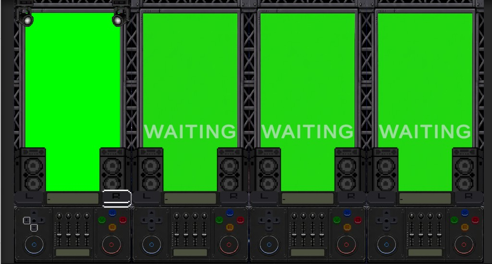
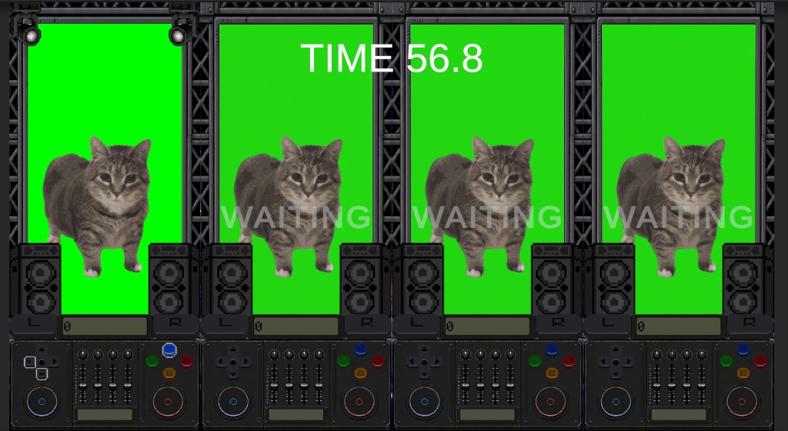
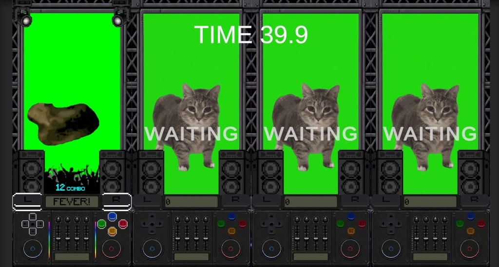
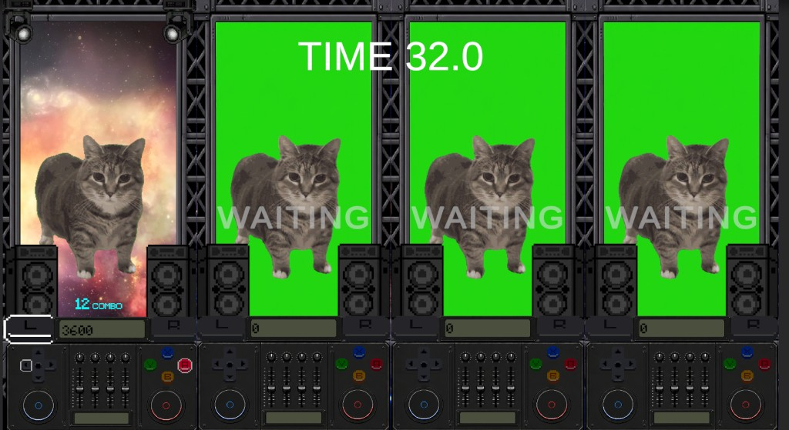
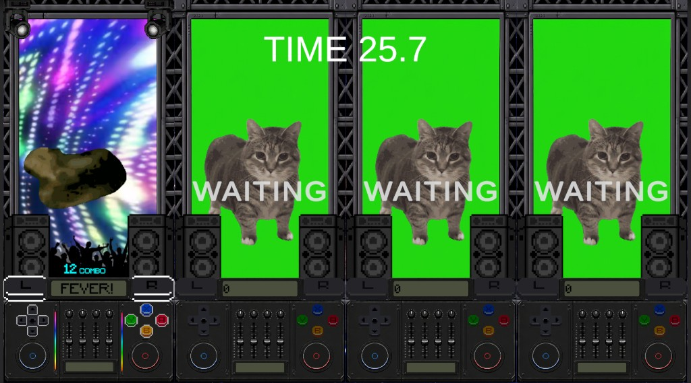

# 05_OIIA

> 문서 기준일: 코드·씬 파일 직접 분석 (추측 없음). **에디터 조작 가이드·플레이 검증 체크리스트는 본 문서에 두지 않는다** (`Project_Master_Context.md` §2·§3). 검증 타임라인은 `02_개발_진행_일지.md`.  
> **갱신**: 2026-10-26 — T1 빌드업 후 T2. Inspector `mainRoundDurationSeconds`(코드 기본 **26**)·`tier1DurationSeconds`·`bgmStartTimeSeconds`. 연출 필드명은 `uiShakeTier2`·`speakerTier2`.

---

## 0. 현재 상태

> **상태**: T1 빌드업 후 T2 연타(26초·BGM 클립 위치) **Play 확인**(2026-10-26). 2~4P는 미검증.

### 한 줄 요약

4명이 세로 4분할 슬롯에서 SNES **10키**를 연타하는 게임이다. **T1**은 우주 배경만 있는 빌드업(입력·Highlight·연출 없음)이고, **T2**에서 `mainRoundDurationSeconds`(코드 기본 **26**초) 동안 클럽·전 키 정답·관중·스핀·빔·Scream으로 점수를 쌓는다. 입력마다 `oiiaiooiiiai`가 진행돼 12글자마다 보너스가 붙는다.

### 기본 상태 (예전 T3)

판 전체가 예전 「강제 피버」와 같다. 화면에서는 피버라는 모드 이름을 쓰지 않는다. 코드의 `Fever*` 이름은 관중·Scream·떼창에 그대로 쓴다.

| 항목 | 값 |
|------|-----|
| 본게임 | T1 `tier1DurationSeconds`(코드 기본 **5**) 동안 타이머 정지 · 이후 T2에서 `mainRoundDurationSeconds`(코드 기본 **26**) 감소 |
| T1 | 우주(`Bg_Space`)만. 입력 불가 · Highlight 없음 · 고양이·관중·빔·Scream·흔들림 없음 |
| T2 | 클럽 · 10키 Highlight · 전부 정답 · 관중 · 고양이 SpinLoop · Beam · Scream · 떼창 |
| BGM | 라운드 시작과 함께 `mainBgmClip` 루프. 재생 시작 위치는 `bgmStartTimeSeconds`(코드 기본 **0**, 곡의 처음) |

### 핵심 게임플레이

| 항목 | 값 |
|------|-----|
| 입력 | 10키 아무거나. 한 프레임에 여러 키가 눌려도 **1회**로 처리 |
| 정답 | `OnDjHit` — Combo++ · Score+`DjHitScore`(**100**) · SubPattern 진행 |
| 패턴 완성 | 12번째 글자 입력 → +`PatternCompleteBonusScore`(**500**) · `SubPatternMatched = 0` · 가이드·게이지 초기화 |
| 입력 경로 | `DjPadInput.cs` → `BoothUsbSlotInput` |
| Dev God | Backspace — 1P 타이머 정지 |

---

## 1. 게임 목적

### 플레이어가 해야 할 일

- **T1**이 끝난 뒤 `mainRoundDurationSeconds`(코드 기본 **26**초) 동안 10키를 최대한 많이 누른다.
- 입력마다 패턴 `oiiaiooiiiai` 진행도가 오르고, 스피커·가이드·떼창이 반응한다.
- 12글자를 채울 때마다 보너스 **+500**.

### 승리·실패

- **점수 경쟁**: 종료 후 점수가 높을수록 Result 등수가 높다.
- **라운드 후 HP** (`OiiaHpLossRules`):
  1. 최종 점수 ≤ `HpLowScoreThreshold`(코드 **8000**) 또는
  2. 참가 2명 이상일 때 **하위 50%**(2→1, 3→1, 4→2)
- 해당 시 Result에서 HP −1. HP 0 → GAME OVER (`01_프로젝트_개요.md` 파티·세션 규칙).
- HP 컷 8000은 연타 규칙에서 Play 후 조정 예정.

### 연습

씬 안 연습 **없음**. Pigeon·RBC처럼 메인 메뉴 JOIN/READY/Enter 후 바로 본게임 (`GameFlowDirector`에서 OIIA `_sessionPractice = false`).

---

## 2. 플레이 흐름

```
메인 READY/Enter → PrepareRound(false) → Minigame_O.I.I.A.
  └─ OiiaSceneBootstrap.Start
       └─ OiiaMinigameModule.Begin(본게임)
            → UpdateGlobalTierFeverMode → 참가 슬롯 BeginTier3ForcedFever
            → 고양이 SpinLoop · 배경 Club

본게임:
  Tick → 시간 감소 · UpdateGlobalTierFeverMode
       → 슬롯별 입력 · 연출 · FlushUi
  → 시간 0 / Escape → CompleteSession
       → MinigameExitSequence → Result
```

슬롯 Tick 대략 순서:

```
TickMeta (입력잠금 · TickFever)
  → TickGameplay (전키 정답)
  → CatAnimator · UiShake
  → Spotlight · StageBackground · Speakers · Crowd
  → FlushUi
```

---

## 3. 화면 구성

### 플레이어 번호 vs 슬롯

- 데이터(HP·점수·참가)는 `PartySession` **플레이어 번호 0~3**.
- OIIA UI는 세로 **4분할** 슬롯으로 보여 준다 (다른 미니게임 배치와 무관).

### 레이아웃

씬 `Minigame_O.I.I.A..unity` · `Panel_O.I.I.A._4Way` 아래 왼쪽부터 SlotPanel_1~4 (앵커 0~0.25 … 0.75~1.0).

```
┌──────────┬──────────┬──────────┬──────────┐
│  슬롯 1P │  슬롯 2P │  슬롯 3P │  슬롯 4P │
│ StageScreen (전광판·고양이·스포트라이트) │
│ Crowd / Speakers / DjBox / HUD         │
└──────────┴──────────┴──────────┴──────────┘
        중앙 상단: TIME (본게임만)
```

슬롯 패널 루트에 `RectMask2D`(`clipSlotContentToPanel`)로 옆 슬롯 오버랩 클리핑.  
비참가 슬롯은 전광판 위에 **`WAITING`** 오버레이.

### 상태별 스크린샷 (1P 참가 · 2~4P WAITING · 2026-07-22 · 개편 전)

캡처 경로: `Documentation/images/oiia/`. 아래 표는 **1P 슬롯** 기준 시각 상태.  
2026-10-25 개편 후 본게임은 **T3 화면이 기본**이다. 단 HUD는 `FEVER!` 대신 Score이고 게이지는 패턴 진행도다. 연습·T1·T1 피버·T2 화면은 더 이상 나오지 않는다(새 캡처 전까지 참고용).

| 상태 | 파일 | TIME | 전광판 배경 | 고양이 | HUD | 관중 | 비고 |
|------|------|------|-------------|--------|-----|------|------|
| **연습** | `01_practice.png` | 없음 | ChromaKey(녹) | **숨김** | Score/`-` 수준 · FEVER 없음 | 없음 | DjBox·스피커만 보임 |
| **T1** | `02_tier1.png` | 있음 (예: 56.8) | ChromaKey(녹) | Idle(정지) | Score | 없음 | Fixture 스포트라이트 |
| **T1 피버** | `03_tier1_fever.png` | 있음 (예: 39.9) | ChromaKey(**유지**) | Spin | **`FEVER!`** · Combo | **있음** | 배경은 T1 크로마키 유지 |
| **T2** | `04_tier2.png` | 있음 (예: 32.0) | **Space**(우주) | Idle | Score · Combo | 없음 | 피버 진입 없음 |
| **T3** | `05_tier3.png` | 있음 (예: 25.7) | **Club**(클럽 네온) | SpinLoop | **`FEVER!`** · Combo | **있음** | 강제 피버 · L/R 등 전키 Highlight 가능 |

#### 연습



#### T1 (비피버)



#### T1 피버



#### T2



#### T3 (강제 피버)



### 슬롯 패널 구조 (`OiiaSlotPanel` · AutoWire 이름)

| 이름 | 역할 |
|------|------|
| `StageScreen` | 전광판 루트 · Bg_ChromaKey / Bg_Space / Bg_Club · Cat · SpotlightL/R |
| `DjBox` | 디제잉 박스 · HudDisplay(Score · Fever는 숨김) · Combo · FeverGauge×2(패턴 진행) · SubPatternGuide · Speakers · Crowd |
| `SpeakerL` / `SpeakerR` | Body · WooferTop · WooferBottom (스크린샷 L/R 캐비닛) |
| `Crowd` / `CrowdPeople` | 관중 실루엣 (판 내내) |
| `Ready` / `Waiting` | Ready 텍스트는 항상 숨김 · 비참가 WAITING |
| 슬롯 배경 Image | `SlotPanelBackgroundImage` |

---

## 4. UI 바인딩 (`SlotUiBindings` / `OiiaSlotPanelBindings`)

| 필드 | 역할 |
|------|------|
| `PracticeReadyText` · `WaitingText` · `SlotPanelBackgroundImage` · `CatAnimator` | 공통 |
| `DjBoxRoot` · Face/Dpad/Shoulder · `DjPadButtons[10]` | SNES 10키 |
| `HudScoreText` · `HudFeverText` | Score 항상 표시 · `HudFeverText` 항상 숨김 |
| `HudComboText` | `{n}<size=55%> COMBO</size>` |
| `FeverGaugeImage` · `FeverGaugeImageB` | 패턴 게이지 Filled ×2 · `SubPatternMatched / 12` · 완성 시 0 (프리팹명 `FeverGauge_L` / `FeverGauge_R` 가능) |
| `SubPatternGuideText` | `oiiaiooiiiai` 맞춘 접두 대문자만 |
| `SpeakerL/R` Root·Body·WooferTop·WooferBottom | 스피커 |
| `StageScreenRoot` · StageBackground Chroma/Space/Club | 전광판 |
| `CrowdRoot` · `CrowdImage` | 관중 |
| `SpotlightL/R` Root·Fixture·Beam | 스포트라이트 |

---

## 5. 입력

### 디제잉 10키 (`OiiaDjPadButtonId`)

| Id | 부스 경로 |
|----|-----------|
| A/B/Y | Face A/B/Y |
| X | Primary Trigger |
| L/R | Shoulder L/R |
| Up/Down/Left/Right | Stick 방향 |

### 운영자·기타

| 입력 | 동작 |
|------|------|
| Escape | 세션 조기 종료 |
| Backspace | Dev God Mode (1P) |

무시: EMPTY 슬롯.

---

## 6. 게임 규칙

### 입력

1. T2 시작부터 10키 전부 Highlight. T1에는 Highlight 없음.
2. 어떤 키든 정답.
3. 같은 프레임 다중 입력은 1회로 처리.

### SubPattern `oiiaiooiiiai`

| 상황 | 동작 |
|------|------|
| 입력 1회 | 진행 +1 · 가이드·스피커·스텝 SFX(떼창) |
| 12번째 입력 | 보너스 +500 · 진행도 **0** · 가이드·게이지 비움 · 12번째 SFX는 `steppedPosition` 반환으로 재생 |

### 연출 요약

| 시스템 | 트리거·동작 |
|--------|-------------|
| UiShake | T2 정답 임펄스 `uiShakeTier2` + 상시 `uiShakeIdleTier2` |
| Speakers | T2 패턴 스텝 → 우퍼 펄스 · O/I/A 글자 분출 · `speakerTier2` |
| Spotlight | T2만 Fixture·Beam |
| StageBackground | T1 **Space** · T2 **Club** |
| Crowd | T2 시작 Rising→Active |
| CatAnimator | T1 숨김 · T2 SpinLoop |
| Slot clip | 패널 `RectMask2D` |

---

## 7. 점수

| 이벤트 | 점수 |
|--------|------|
| 입력 1회 (`OnDjHit`) | **+100** (`DjHitScore`) |
| 패턴 12글자 완성 | 추가 **+500** (`PatternCompleteBonusScore`) → 완성 입력은 +600 |

`Balance.cs`에는 `DjHitScore`·`PatternCompleteBonusScore`·`HpLowScoreThreshold`만 있다.

---

## 8. 오디오

| 채널 | 동작 |
|------|------|
| `mainBgmClip` | 본게임 단일 루프 (`TierBgm.cs` · `tierBgmVolume`) |
| `patternStepSfx[12]` | 본게임: `PlayFeverChantStep`(떼창) |
| FeverChant | 원본 레이어 + 피치/볼륨/지연 분산 레이어 · 풀 런타임 생성 |
| `feverScreamClip` | 본게임 내내 루프 · 전용 AudioSource |
| `buzzClip` | **필드 삭제** (2026-10-25). 미스 사운드 경로 없음 |
| `sessionEndClip` | 씬 **미연결**(의도적 가능) |

---

## 9. 코드 구조

### 진입

| 파일 | 역할 |
|------|------|
| `OiiaSceneBootstrap.cs` | PartySession → `Begin` / `Tick` |
| `OiiaMinigameModule.cs` | `IMinigameModule` · `BuiltInId = "oiia"` |
| `OiiaSlotPanelBindings.cs` | 프리팹 AutoWire → `SlotUiBindings` |

### partial (`OiiaMinigameModule.*`)

| 파일 | 역할 |
|------|------|
| `Begin` / `Tick` / `ExitSequence` | 수명주기 |
| `PracticeFlow` | Escape 조기 종료만 |
| `Gameplay` / `DjPadInput` / `DjPadVisual` | 판정·입력·L/R·ABXY Unpressed |
| `Fever` / `FeverAudio` / `FeverChant` | 기본 상태(전 키 정답·관중)·Scream·떼창 |
| `SubPatternGuide` | 패턴 진행·가이드 UI |
| `Speakers` / `Crowd` / `UiShake` | 연출 |
| `Spotlight` / `StageBackground` / `CatAnimator` | 전광판·조명·고양이 |
| `TierBgm` / `PatternAudio` | BGM·스텝 SFX |
| `Ui` / `SlotPanels` / `SlotEmptyUi` / `SlotHelpers` | UI·클리핑 |
| `Timer` / `Balance` / `Constants` / `Types` / `Config` / `State` / `DevGodMode` | 공통. `GlobalTier.cs`는 삭제 |

### 기타

| 파일 | 역할 |
|------|------|
| `OiiaHpLossRules.cs` | Result HP 감소 대상 |
| `OiiaVideoEffectController.cs` | 크로마키 MP4 유틸 · **모듈에서 미호출(고아)** · 정리 후보 |

### 제거된 레거시 (문서·코드 기준)

BurstText · ShuffleEffect · ButtonShuffle · GuideFeedback · GaugeSlider 드레인 · SequenceText · BlurFx · CatMovement · MapO/I/A · 연습 큐 · T1/T2 시간표 · 3키 판정·미스 · 3초 피버 · `GlobalTier.cs` · `buzzClip` · Balance 티어 헬퍼 (2026-10-25).

---

## 10. 씬

- 씬: `Assets/Scenes/Minigame_O.I.I.A..unity`
- 모듈 루트 예: `O.I.I.A._Root` + `OiiaMinigameModule` + `OiiaSceneBootstrap` + AudioSource
- 컨테이너: `Panel_O.I.I.A._4Way` → 슬롯 패널 4 · `FadeOverlay` · `Timer`

---

## 11. Inspector (`Minigame_O.I.I.A.` 씬 튜닝 · 2026-07-18)

### 핵심 연결

| 필드 | 씬 |
|------|-----|
| `displayName` | OIIA |
| `mainRoundTimerCentralTop` | Timer 연결 |
| `slotPanels[4]` · `slotPanelsContainer` | 연결 · `clipSlotContentToPanel` ON |
| `sfxSource` | 동일 GO AudioSource |
| `mainBgmClip` | 연결 |
| `patternStepSfx` | **12**개 연결 |
| `feverScreamClip` | `Scream.mp3` · Source 런타임 |
| `buzzClip` · `sessionEndClip` | **비어 있음** |
| `speakerLetterTemplate` | 연결 |
| `exitScreenFader` | FadeOverlay |

### 튜닝 수치 (씬)

| 그룹 | 값 |
|------|-----|
| UiShake 정답 | `uiShakeTier2` (옛 `uiShakeTier3` 씬 값) |
| UiShake 상시 | `uiShakeIdleTier2` (옛 `uiShakeIdleTier3` 씬 값) |
| FeverChant | Layer **12** · Pool **32** · Pitch **0.98~1.02** · Vol **0.5~1** · Delay **0.15s** |
| Crowd | Rise 120 · Rise/Fade 0.35/0.4 · Shake Amp **10** · Freq **3** · AutoPlace **OFF** |
| Speaker | `speakerTier2` (옛 `speakerTier3` 씬 값) |
| 본게임 시간 | `mainRoundDurationSeconds` 코드 기본 **26**. 씬에 없으면 코드 값. 최소 `MainRoundMinSeconds` **1** |
| T1 | `tier1DurationSeconds` 코드 기본 **5**. 씬에 없으면 코드 값 |
| BGM 시작 위치 | `bgmStartTimeSeconds` 코드 기본 **0**(초). 클립 길이보다 크면 끝 0.05초 전으로 맞춤 |
| Spotlight | `spotlightBeamAlpha` **0.15** |
| Stage BG | T1 Space · T2 Club. 크로스페이드 필드 삭제 |
| DjPad | ABXY Unpressed 명도 **100** · L/R Highlight black 스프라이트 연결 |
| BGM | `tierBgmVolume` **0.85** · `tierBgmSource` 비움(런타임 생성) |
| Cat | Idle / SpinOnce / SpinLoop |

코드 상수: `DjHitScore` **100** · `PatternCompleteBonusScore` **500** · HP 컷 **8000**. 본게임 시간은 Inspector `mainRoundDurationSeconds`.

`uiShakeTier2`·`uiShakeIdleTier2`·`speakerTier2`는 예전 `*Tier3` 씬 저장값을 `FormerlySerializedAs`로 읽는다.

---

## 12. 데이터 흐름

### 시작

```
Begin(본게임) → UpdateGlobalTierFeverMode → BeginTier3ForcedFever(참가 슬롯)
  → 10키 Highlight · Crowd 상승 · Scream
  → 고양이 SpinLoop · 배경 Club
```

### 입력

```
CollectDjPadPressed → OnDjHit
  → Combo++ · AdvanceSubPatternOnHit(out patternCompleted) → steppedPosition
  → Score += 100 · (patternCompleted) Score += 500, SubPatternMatched = 0
  → UiShake · Speakers(Notify)
  → PlayPatternStepSfx(steppedPosition, 떼창)
```

---

## 13. Result 연동

| 항목 | 내용 |
|------|------|
| Report | `MinigameId = "oiia"` · `FinalScore` · `HpLostThisSession` |
| HP | `OiiaHpLossRules.FillHpLost` |
| Result UI | 전 미니게임 **공통** `Results` 씬 |

---

## 14. 구현 진행도

### 완료

- T1 우주 빌드업(입력·Highlight 없음) 후 T2 연타 · `mainRoundDurationSeconds` **26** · `bgmStartTimeSeconds` · **Play 확인**(2026-10-26)
- 연습·옛 시간 티어·3키·3초 피버·Balance 티어 헬퍼 **삭제**
- SubPatternGuide · Speakers · Crowd · UiShake · Scream · FeverChant
- 슬롯 RectMask2D 클리핑 · ABXY Unpressed 명도 · Result/HP

### 미완·후속

- HP 컷 8000 조정
- 2~4P·부스 다패드 재검증
- `buzzClip` / `sessionEndClip` 연결 여부
- `OiiaVideoEffectController` 사용처 정리(선택)

---

## 15. AI 참고

### 수정 시 주의

- 패턴 문자열·`patternStepSfx` 길이(12) 동기화.
- 패턴 완성 시 `SubPatternMatched` 리셋 → 스텝 SFX는 **`steppedPosition` 반환값** 사용.
- 기본 상태는 `Begin`과 `Tick`에서 입력보다 **먼저** `UpdateGlobalTierFeverMode`.
- 점수 경로: `DjHitScore` + `PatternCompleteBonusScore`만. `ScorePerCorrectStepForTier` 등은 호출하지 않음.
- 에디터 Step-by-Step 가이드는 **채팅에만** (`Project_Master_Context.md` §2).

### 디버깅 우선 위치

| 증상 | 확인 |
|------|------|
| 입력 무반응 | `DjPadInput` · `BoothUsbSlotInput` · `_aliveMask` |
| 시작 연출 안 켜짐 | `Begin` → `UpdateGlobalTierFeverMode` · `_baseFeverActive` |
| 보너스 안 붙음 | `AdvanceSubPatternOnHit` `patternCompleted` → `OnDjHit` |
| 마지막 I 무음 | `AdvanceSubPatternOnHit` 반환값 → `PlayPatternStepSfx` |
| 옆 슬롯 침범 | `clipSlotContentToPanel` · `RectMask2D` |
| Scream/떼창 | `FeverAudio` · `FeverChant` · Begin/Exit Stop |
